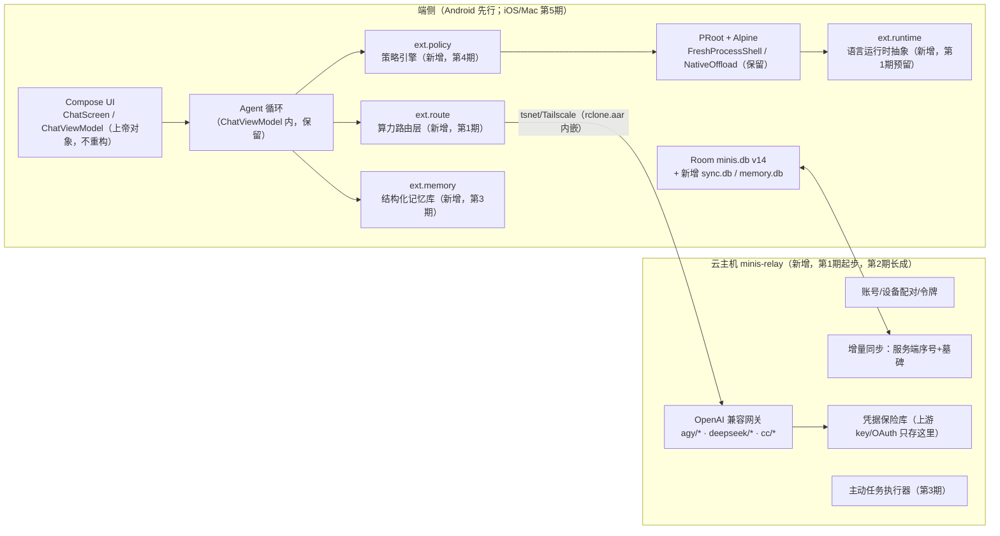

# Minis 架构设计稿 v1（草案，非代码）

- 作者：总架构师（Claude Opus 5.5）
- 日期：2026-11-27
- 基线：上游 OpenMinis HEAD `1a71df0f381cefde80bf912b723de6f9831bc177`（`0-beta-build47`，v1.15），本机 `/home/ubuntu/minis-src`
- 验收标尺：`research/TARGET-muse-baseline.md`（下称「基线」，十域）、`research/ROADMAP-small-goals.md`（下称「路线」，G01–G49）
- 证据来源缩写：
  - 【C】= `research/claude/report.md`（缪斯线，分区号 P01–P29 为该报告自有编号）
  - 【G】= `research/gemini/MASTER-REPORT.md`（谷歌线，分区号 P01–P29/D1/D2/V1 为该报告自有编号，**与【C】的 P 编号不是同一套**）
  - 【D】= `research/dsh/report.md`（DSH 线）
  - 【源】= 本稿撰写时我亲自打开核对过的源文件与行号
  - 【未验证】= 我没有亲自核实、也没有在三份报告里找到可复核证据的判断；必须在实测中确认
- 本稿只是设计，不含实现代码；文中出现的接口签名是「契约草图」，用于约束后续实现，不是可编译代码。

---

## 1. 目标架构（一页纸）

### 1.1 一句话

**保留 Minis「端上 Agent + 端上 Linux 沙箱 + 原生能力桥」这一最值钱的部分不动，在它外面补三根骨架：算力路由层（第 1 期）、自有账号/中继/同步面（第 2 期）、带来源的记忆与主动层（第 3 期），再在执行入口收紧治理（第 4 期），最后把同一套契约带到 iOS/Mac（第 5 期）。**

这和【C】「结论先行」第 1 条的判断一致：Minis 是成熟的「单机 Agent 客户端」，缺的是「统一账号与跨设备数据面、带来源的记忆、系统级审批与审计」三根骨架，不是缺功能。

### 1.2 三个平面



- **端侧执行面**：Agent 循环、沙箱、原生能力全部留在设备上。理由：【C】§5 边界 1——「把 agent 循环整体搬上服务器会杀死这个产品最值钱的部分」（原生能力面约 20 个能力域，【C】架构理解·沙箱与原生桥）。
- **算力面**：手机只认「路由」，不认上游厂商。DeepSeek 可直连；Antigravity（Opus 5.5 / Gemini 4 Neon）只能经云主机网关（理由见 §3.2 决定 D1）。
- **数据/账户面**：第 2 期起，云主机 `minis-relay` 成为记忆与任务状态的权威副本（source of truth），端侧是缓存 + 离线写队列。

### 1.3 双原生结构如何映射到十个基线域

| 基线域 | Android（Kotlin/Compose + PRoot）现状 | iOS（SwiftUI + iSH）现状 | 处理 | 落在哪期 |
|---|---|---|---|---|
| 一 对话与推理 | 循环在 `ChatViewModel.kt`（20,341 行【源】）；四级裁剪 + `CompactMarker` v2 + 15K 卸载【G】§2；子代理深度 1、全局 6/每父 3【G】§2 | 循环在 `AIChatViewModel+AgentLoop.swift` 单函数约 2,000–2,300 行【C】【D】 | **保留**循环；**新增**路由层与按任务选模；深度研究模式靠技能装配 | 1 |
| 二 工具与执行环境 | PRoot + `FreshProcessShell` + 23（或 20/21，见 §8.4）个 offload handler；浏览器池；Skills；MCP；定时任务 | iSH + 28 个 offload【G】 | **保留**；新增语言运行时抽象（G49 预留）；修沙箱串扰缺陷 | 0–1 |
| 三 记忆 | `GLOBAL.md` + 每日日志，整段注入，无来源/置信度/取代链【C】架构理解·记忆；`MemoryTools.kt` 只写日志【源】`tools/MemoryTools.kt:29` | 同构 | **新增**结构化记忆库，Markdown 降为只读导出 | 3 |
| 四 主动性 | 只有端上定时任务（AlarmManager+FGS）【G】§2 | 静默音频/定位保活【G】§2 | **新增**服务端 watcher；端上仅兜底 | 3 |
| 五 连接与账户 | 无账号；无同步；仅 `.minisbak` 手动备份【C】【G】 | CloudKit v1/v2，v2 墓碑被禁用【G】§1-8 | **新增**自有账号与中继同步；不移植 iOS CloudKit v2 | 2 |
| 六 设备与现实操作 | 无障碍、Shizuku、浏览器 offload 已有；Shizuku 多处语义反转（P0）【G】§5 | HomeKit/Health 等 offload | **保留**，先修 P0；Mac 控制留到第 5 期 | 0/4/5 |
| 七 产物生成 | WebApp 产物「添加到主屏幕」被 `if (false && …)` 杀死【C】【G】§6；rclone 远端已在 | 同 | **改造**：产物交付走 rclone/中继持久存储（G34） | 3 后 |
| 八 协作与调度 | 子代理注册表易失、恢复子任务永不 finish 的泄漏【C】跨模块关键流 4 | 同构 | **改造**：子代理按任务选路由；结果裁决记录 | 1/3 |
| 九 安全与治理 | 未注册工具默认 BYPASS【源】`OffloadPermissionManager.kt:402`；五类 offload 无闸【C】结论 5；`minis-config` 确认门 + 审计库【G】§3-5 | 首词匹配可被 `sh -c` 绕过【G】§5 P0 | **改造**：执行入口前置策略引擎；审批指纹；哈希链审计 | 0（止血）/4 |
| 十 自我改进 | 无 | 无 | **新增**：服务端后台整理、规矩手册 | 3 |

### 1.4 分期范围（0–5）

| 期 | 主题 | 交付一句话 | 主要 G 目标 |
|---|---|---|---|
| 0 | 构建打通 + 止血 | Windows 笔记本一条命令出 APK，真机装上能跑命令；调试通道与凭据止血；换包名 | G46、G47、G48、G06；G49 排在 G46 之后 |
| 1 | 自有算力 | DeepSeek 直连跑工具回合；Opus 5.5/Gemini 4 Neon 经网关跑思考回合；按任务选模；记账 | G01、G02、G03、G04、G42（记账部分） |
| 2 | 统一账号中继 | 手机 + 第二设备同一身份；会话/记忆/任务增量同步；上游凭据只在服务端 | G24、G25、G26、G27 |
| 3 | 记忆 + 主动性 | 记忆三层 + 溯源 + 纠正遗忘；目标系统；服务端 watcher 只报异常；后台整理 | G14–G23、G43–G45 |
| 4 | 治理收紧 | 默认 ASK_ONCE；四类硬敏感必批；审批指纹；哈希链审计；预算闸 | G38–G42 |
| 5 | Mac/iOS | iOS 接入同一中继与记忆契约；Mac 先 CLI 后节点 | G26（跨端）、基线六 Mac/iOS 部分 |

### 1.5 关键架构决定（ADR 摘要）

- **D1 Antigravity 走服务端网关，不在 Kotlin 里复刻协议。**（详见 §3.2）
- **D2 Agent 循环留在端上。** 网关只管算力与账号，不管设备能力（【C】§5 边界 1）。
- **D3 上帝对象「先旁路、后收编」。** 所有新能力的接缝放在 `ProviderFactory.create`、`executeTool` 入口、Repository 层、沙箱 CLI 这四类已存在的窄口上，不在 `ChatViewModel` 内部铺逻辑（详见 §5）。
- **D4 同步不做 CRDT、不做字段级合并。** 会话/消息只追加 + 会话租约；设置后写胜；记忆按条目合并（【C】第 2 期）。
- **D5 Android 先行，iOS 在第 5 期前只跟上游、不改。** 理由：双端零共享代码、靠字节级对等测试维持一致（【C】架构理解），同时改两端会把维护面翻倍。
- **D6 中继服务用 Go。** 理由：App 已经在 `rclone.aar` 里内嵌 Go 版 `tsnet` 节点（【C】结论 4；【源】`deps/build_rclone_android.sh` 头注释），服务端同用 `tsnet` 库可单二进制、只听 tailnet；且 Phase 0 已要求装 Go 1.27.4。备选是 Kotlin/Ktor（可复用端上数据类），但需额外接 Tailscale，否决。

---

## 2. 第 0 期：构建打通（Windows 笔记本）

### 2.1 工具链与环境变量（以 brief 给定版本为准）

| 工具 | 版本 | 用途/证据 |
|---|---|---|
| JDK | 17 | `build.gradle.kts:164-169` 源/目标 17【源】 |
| Android SDK | compileSdk 36、targetSdk 35、minSdk 26 | `build.gradle.kts:33-38`【源】 |
| NDK | r28 | BUILDING.md「NDK r28+」【源】 |
| CMake | 3.22.1（SDK Manager 安装） | `build.gradle.kts:84`【源】；编 `pty_bridge`/crash handler/`jieba_jni` |
| Go + gomobile | Go 1.27.4（`go.mod` 要求 `go 1.25.5`【源】） | `build_rclone_android.sh` |
| GNU Make | 4.3，取 NDK 自带 `%NDK%\prebuilt\windows-x86_64\bin\make.exe` | `build_proot.sh` 调 `make`【源】 |
| Gradle | 8.11.1（wrapper，勿另装） | `gradle-wrapper.properties`【源】 |
| Shell | Git for Windows 的 Git Bash | 仓库只有 Unix `gradlew` |

环境变量（Git Bash 的 `~/.bashrc`）：`JAVA_HOME`、`ANDROID_HOME`、`ANDROID_NDK_HOME=$ANDROID_HOME/ndk/<r28 目录>`、`PATH` 追加 `$ANDROID_NDK_HOME/prebuilt/windows-x86_64/bin`、`$(go env GOPATH)/bin`、`$ANDROID_HOME/platform-tools`。另需 `src/android/local.properties` 写 `sdk.dir`（或依赖 `ANDROID_HOME`）。

### 2.2 源码核查发现的 Windows 阻断点（必须在第 0 期处理）

以下是我逐行读 `deps/build_proot.sh`、`scripts/prepare_android_sandbox.sh`、`deps/build_rclone_android.sh` 后得出的，**都尚未在 Windows 上实测**：

| 编号 | 阻断点 | 证据 | 判断 |
|---|---|---|---|
| W1 | `build_proot.sh` 只认 `Darwin-*` 与 `Linux-x86_64`，Git Bash 下 `uname -s` 是 `MINGW64_NT-…`，直接 `log_error "Unsupported host"` | 【源】`build_proot.sh:119-122`；【G】§1-10 同判 | **必然失败** |
| W2 | 即使加上 Windows 分支，脚本用 `[ -x "$TOOLCHAIN_BIN/${NDK_TRIPLE}${ANDROID_API}-clang" ]` 检查编译器；Windows 版 NDK 提供的是 `.cmd` 包装与 `clang.exe` | 【源】`build_proot.sh:126-140` | 高概率失败【未验证 NDK r28 Windows 包内确切文件名】 |
| W3 | 加载器校验用 `shasum -a 256`；Git Bash 一定有 `sha256sum`，是否带 `shasum` 不确定 | 【源】`build_proot.sh:378-379` | 可能失败【未验证】 |
| W4 | 默认 NDK 探测路径是 `~/Library/Android/sdk/ndk`（macOS） | 【源】`build_proot.sh:100-112` | 必须设 `ANDROID_NDK_HOME` |
| W5 | 仓库**没有 `.gitattributes`**；Git for Windows 默认 `core.autocrlf=true` 会把 `.sh`/`gradlew` 检出为 CRLF，bash 报 `$'\r': command not found` | 【源】仓库根无 `.gitattributes` | **克隆方式不对就必然失败** |
| W6 | proot 的 `make` 由原生 Windows 版 GNU Make 4.3 驱动，recipe 里的 shell 命令依赖 PATH 中的 `sh.exe`（Git Bash 提供）；PRoot Makefile 内部是否有 Windows 不兼容的命令未审 | 【G】§8 未逐行读 `deps/proot` | 【未验证】最大不确定项 |
| W7 | `gomobile` 用 `@latest`，不可复现 | 【源】`build_rclone_android.sh` 注释 | 第 0 期记录实际 commit 并钉死 |
| W8 | Alpine minirootfs 无哈希校验下载 | 【源】`prepare_android_sandbox.sh`（`curl -fSL` 无校验）；【G】§5 P1 供应链 | 第 0 期记录 sha256 |
| W9 | `org.gradle.jvmargs=-Xmx2048m`，编译 2 万行单文件在笔记本上可能 OOM | 【源】`gradle.properties` | 【未验证】出现时改 4g |
| W10 | 文档说 `build_proot.sh` 会「构建并安装」两个 loader；代码里 loader 是**入库的 Termux 冻结二进制**、脚本只做 sha256 比对 | 【源】`build_proot.sh:374-386` vs BUILDING.md Android §1；`git ls-files` 只有两个 loader 入库 | 文档与代码矛盾，**以代码为准**：loader 不用编，`libproot.so`/`proot-aarch64` 才要编 |

### 2.3 方案之争：Git Bash 打补丁 vs WSL2 编原生依赖

- **方案 A（推荐）：Git Bash 单一 shell + fork 内一个「Windows 构建适配」补丁。** 补丁只动 `deps/build_proot.sh`：①`MINGW*|MSYS*` → `host_tag=windows-x86_64`；②编译器改为 `"$TOOLCHAIN_BIN/clang.exe" --target=aarch64-linux-android${ANDROID_API}`，`-x` 检查对 `.exe` 生效；③`shasum` 不存在时回退 `sha256sum`；④`make` 显式取 NDK 自带 `make.exe`。优点：满足 brief「经 Git Bash 构建」，一个环境、一个脚本；补丁小、可回馈。缺点：W6 是未知数，可能要多轮试错。
- **方案 B（兜底）：只把 `build_proot.sh` 放到 WSL2 Ubuntu 跑**（脚本原生支持 `Linux-x86_64`），产物 `proot-aarch64`、`libproot.so` 拷回 Windows 工作树，其余全在 Git Bash。优点：脚本零改动。缺点：两套环境、两份 NDK，「一条命令出包」被拆开，违反 G46 的字面验收。
- **裁决**：先 A；A 在 W6 上卡住超过半天，切 B，并在构建记录里注明「proot 产物来自 WSL2」。两种都要满足 §2.5 的同一套验收。

### 2.4 确切构建路径（方案 A）

```bash
# 0) 一次性：克隆（关键：禁止 CRLF 转换，开长路径）
git config --global core.autocrlf false
git config --global core.longpaths true
git clone --recurse-submodules https://github.com/tanjiawenai-ai/OpenMinis.git /d/dev/OpenMinis
#   Android 只需要 deps/proot；deps/ish 是 iOS 用，可只 init proot 以省时间：
#   git submodule update --init deps/proot
cd /d/dev/OpenMinis
git ls-files --eol deps/build_proot.sh src/android/gradlew   # 必须显示 w/lf

# 1) 构建期定制（可以留空）
cp src/android/app/provider-customization.properties.example \
   src/android/app/provider-customization.properties

# 2) 原生依赖（顺序有依赖）
./deps/build_proot.sh                  # → assets/proot-aarch64, jniLibs/arm64-v8a/libproot.so；校验两个入库 loader 的 sha256
./scripts/prepare_android_sandbox.sh   # → assets/alpine-minirootfs.tar.gz（Alpine 3.21.3）
./deps/build_rclone_android.sh         # → deps/build/rclone/rclone.aar（含 tsnet + nethub，单 Go 运行时）
mkdir -p src/android/app/libs && cp deps/build/rclone/rclone.aar src/android/app/libs/

# 3) 打包与安装（github 是默认 flavor，assembleDebug 是 githubDebug 的别名，见 build.gradle.kts:216-259）
cd src/android
./gradlew clean :app:assembleDebug
./gradlew :app:installDebug
```

建议在 fork 里把 1)–3) 收成一个 `scripts/build_android_windows.sh`（第 0 期产物，**本稿不创建**），这才是 G46 所说的「一条命令」。

**调试签名**：debug 与 release 都用 `signingConfigs.debug`【源】`build.gradle.kts:107,129`。AGP 首次构建在 `%USERPROFILE%\.android\debug.keystore` 自动生成。约束：①把这个 keystore 备份进私有位置——换机器换 key 就无法覆盖安装、只能卸载重装并丢数据；②换包名（G47）后首次安装与上游 Minis 共存，不冲突。第 0 期不建正式 release keystore；第 2 期前（要分发给第二台设备）再建。

### 2.5 「构建通过」的定义（全部满足才算 G46 达成）

1. **干净起点**：新克隆（或 `git clean -xfd` 后）执行一条构建脚本，退出码 0。
2. **产物存在**：`app/build/outputs/apk/github/debug/*.apk` 存在；记录其 sha256、大小、构建耗时、各工具版本（`java -version`、`go version`、NDK `source.properties`、gomobile commit、Alpine 包 sha256）。
3. **APK 内容**：`unzip -l app-github-debug.apk | grep -E 'libproot(-loader|-loader32)?\.so|libgojni\.so'` 四个都在。BUILDING.md 明确警告：缺 loader 时沙箱「看起来正常」但第一条 `execve` 就失败【源】BUILDING.md Troubleshooting。
4. **真机安装**：`adb install -r` 成功，arm64 真机（`abiFilters` 只有 `arm64-v8a`【源】`build.gradle.kts:70`）。
5. **启动**：冷启动进入 Compose 主界面，**不是**崩溃分享对话框（`subsystemsInitialized` 为假时只显示该对话框【D】§3，`MainActivity.kt:252-290`）。
6. **沙箱真能跑**：在 App 内让 shell 执行 `echo ok; uname -m; exit 0`，断言退出码 0、输出含 `aarch64`。只看「沙箱启动了」不算（BUILDING.md 原话）。
7. **持久**：写 `/var/minis/workspace/p0.txt`，杀进程重启后仍在（同时满足 G06）。
8. **留档**：一份真机测试记录（机型、Android 版本、上述 1–7 的截图/日志），即 G48 的第 0 期记录。

### 2.6 第 0 期止血清单（与出包并行，属于 fork 内的小改动）

| 项 | 依据 | 验收 |
|---|---|---|
| 改 `applicationId`、品牌名、图标（G47）；**保留 Kotlin `namespace` 不改**以减少与上游的 diff | 【C】第 0 期；Gradle 允许 applicationId ≠ namespace | `aapt dump badging` 无上游品牌 |
| 关上游自更新：`github` flavor 的 `AUTO_UPDATE_CHECK`/`SELF_UPDATE` 置 false（或新增私有 flavor） | 【源】`build.gradle.kts:146-160`；【C】「更新摘要缺失时跳过校验」 | 抓包无 GitHub Releases 请求 |
| DebugServer：只绑回环、回环也要令牌；`provider.export` 在非 DEV_TOOLS 构建物理移除 | 【源】`DebugServer.kt:91-98` 用 `ServerSocket(port, 10)` 绑全部网卡，`isAuthorized` 对回环一律放行（`:39-41`）；【G】§5 P0 | `ss -ltn` 只见 127.0.0.1；无令牌回环请求被拒 |
| 备份默认加密、默认不带凭据 | 【C】跨模块关键流 3；【G】§1-7 | 默认导出包里 grep 不到 key |
| Gemini API key 不再走 URL 查询串 | 【C】第 0 期（P25 三处） | 日志无 `key=` |

### 2.7 G49 排队位

G49 排在 G46 出包之后、第 1 期执行层定型之前（路线原文）。第 0 期只需保证：Alpine 沙箱可 `apk add`、可放入外部工具链二进制、有可写持久目录——这些在 §2.5 第 6、7 条已经覆盖。

---

## 3. 第 1 期：自有算力

### 3.1 现有接缝（决定了「不进上帝对象」是可行的）

- 统一接口：`interface LLMProvider`，核心是 `streamMessageClamped(messages, systemPrompt, maxTokens, temperature, imageParts, tools, thinkingLevel): Flow<LLMStreamChunk>` 与 `sendMessageClamped(...)`【源】`provider/LLMProvider.kt:17-128`。
- 唯一工厂：`ProviderFactory.create(instance, apiKey, model, context, sessionId, overrides): LLMProvider`，按 `instance.providerType` 分发【源】`provider/ProviderFactory.kt:39-77`。
- `ChatViewModel` 在约 10 处调用 `ProviderFactory.create`（如 `ChatViewModel.kt:6490, 7218, 7293, 7597, 7646, 7792, 7880, 7954, 8620, 9426`【源】）——**全部经过工厂**，所以在工厂里包一层即可影响所有调用点，不用改 `ChatViewModel`。
- 用量结构已存在：`LLMUsage(inputTokens, outputTokens, cacheCreationInputTokens, cacheReadInputTokens, latestContextTokens, reasoningTokens, cacheReported)`【源】`data/model/LLMUsage.kt:6-30`；`usage/` 包有 `ProviderUsage/StoredUsage/UsageReport`【源】目录列表；`quota/` 包有配额适配器框架【G】§9.3。
- DeepSeek 已被当作一等公民处理：`ProviderFactory` 注释专门处理 `https://api.deepseek.com/v1` 的四种 baseURL 形状【源】`ProviderFactory.kt:61-75`；`DsmlLeak.kt` 处理 DeepSeek 工具调用漏进 reasoning 通道（官方 API 实测 5/25 次泄漏）【源】`provider/DsmlLeak.kt:1-25`。

### 3.2 三条路线

| 路线 | 接法 | App 侧改动 | 状态 |
|---|---|---|---|
| **R-DS 执行线**：DeepSeek 官方 API | `ProviderType.openAI` + `customBaseURL=https://api.deepseek.com`，走 Chat Completions | **零代码**（现有 UI 可配） | 第 1 期首日可跑 |
| **R-AG 思考线**：Claude Opus 5.5、Gemini 4 Neon（经 Antigravity） | 云主机网关 `minis-relay` 以子进程包 `agy`，对外暴露 OpenAI 兼容 `/v1/chat/completions` 与 `/v1/models`；手机以 `openAI` 类型 + 自定义 baseURL 指向网关 tailnet 地址 | 零代码先行；后补模型目录拉取、网关健康徽章 | 需建网关 |
| **R-CC**：CommandCode 中转 | 同为 OpenAI 兼容自定义 baseURL；路线 G01 要求的第三条 | 零代码 | brief 未列，按 G01 补 |

**决定 D1：为什么 Antigravity 不在端上接。**
- 方案甲「把 iOS 的 Antigravity 实现移植到 Kotlin」：Android 的 `ProviderType.antigravity` 是「decode-only」、`isUsable=false`【源】`data/model/ProviderConfig.kt:62-91`；双端 OAuth 都硬编码占位 `GOCSPX-xxxx` client secret【G】§1-6、§6；协议走未公开的 `v1internal`，要伪造客户端身份、信封包装、`thoughtSignature` 逐消息回放【C】结论 3。成本高、封号面大、出厂即坏。
- 方案乙「云主机网关包 agy」：agy 在云主机上已有一个活的、付费的会话；App 本来就会说 OpenAI 协议且支持自定义 baseURL；手机到云主机的传输层（tsnet）已内嵌【C】结论 3、4。
- **推荐乙**，附三条硬条件（全部来自【C】§5）：①网关按会话钉住上游，reasoning 产物只回放给签发它的上游（issue #368）；②不得做「谁都能顶上」的无状态转发；③保留 DeepSeek 直连作为网关故障兜底组，但兜底是「临时顶替、恢复回主」，不许永久改写会话绑定（iOS 现行行为 GH#229 是反例；Android 同样缺冷却回主机制【G】§5 P1）。
- **前置实验门（半天，不过不盖楼）**：agy 带工具 schema 的结构化 `tool_calls` 合法率，20 次 ≥ 90% 才允许 R-AG 进工具回合；否则 R-AG 只做无工具回合（规划、审阅、写作），工具回合默认 R-DS（【C】第 1 期）。这就是 G02 说的「R1 实验门」。
- **未决**：agy 的使用条款是否允许程序化转供自用客户端【未验证】；agy 内「Gemini 4 Neon」「Opus 5.5」的确切模型 ID 与上下文窗口【未验证，【C】只说「27 个模型含 Opus 5.5、Gemini 4 全家」】。
- **协议选择**：网关对 App 只开 Chat Completions，不开 Responses。理由：Android Responses API 路径完全不回传 `reasoning`【G】§1-5，`ThinkingPassbackMatrixTest.kt:294-298`。

### 3.3 Provider 抽象设计（一个接口、可切换路由、按任务选模、记账）

**原则：不新造第二套 provider 接口，`LLMProvider` 就是那「一个接口」。新增的是它上面的路由与记账装饰层。**

契约草图（新包 `com.openminis.app.ext.route`）：

```text
ComputeRoute            // 一条算力路线
  id: String            // "ds-direct" | "relay-agy" | "relay-cc" ...
  kind: DIRECT | RELAY
  providerInstanceId    // 复用现有 ProviderInstance（compositeKey = instanceId/modelId，【G】§2）
  credentialRef         // 指向凭据，不存明文；第2期起 RELAY 只持设备令牌
  capabilities          // tools / vision / reasoningEcho / maxContext（来自 models-dev 目录补全）
  pinPolicy: PIN_PER_SESSION | FREE

TaskClass = MAIN_TOOL_LOOP | SUBAGENT | COMPACTION | TITLE_FOLDER | VISION
          | PLAN_REVIEW | VOICE_CORRECTION | MEMORY_CONSOLIDATION | BRIEFING

TaskModelPolicy
  resolve(taskClass, sessionPin?) -> RouteChoice(primary, fallbacks[])

RoutedProvider : LLMProvider      // 装饰器：包住 ProviderFactory 造出的真实 provider
  - 记录 requestId、taskClass、routeId、model
  - 流结束时把 LLMUsage 写入 CostLedger
  - fallback 时打 "temporary substitute" 标记，不改会话绑定
  - 预算闸（第4期 G42）在发送前查询 BudgetGate
```

**插入点**：`ProviderFactory.create` 的返回值外包一层 `RoutedProvider`——这是唯一要改的上游函数（数行）。`TaskClass` 的识别在第一版里由调用点推断：`ChatViewModel` 的主循环调用 = `MAIN_TOOL_LOOP`；`HelperRunner` 调用 = `SUBAGENT`；`VisionGroupResolver` = `VISION`；`oneOffSessionId()` 的一次性调用（文件夹建议、语音纠错，见 `ProviderFactory.kt:44-50` 注释）= `TITLE_FOLDER`/`VOICE_CORRECTION`。这些都靠工厂的 `sessionId`/调用栈参数区分，不进 `ChatViewModel` 内部【部分未验证：HelperRunner 与 VisionGroupResolver 的具体调用参数需实测】。

**与现有机制的关系（避免两套）**：
- `ModelGroup`（fallback/loadBalance）保留，作为 `RouteChoice.fallbacks` 的数据来源；只改「失败后永久切换」为「冷却后回主」。
- `VisionGroupResolver` 保留，作为 `TaskClass.VISION` 的实现。
- 用量页（`usage/`）保留展示；`CostLedger` 是它的数据底座升级。

**记账数据模型（新库 `ledger.db`，不动 `minis.db` v14）**：

| 字段 | 说明 |
|---|---|
| request_id | UUID，端侧生成，网关透传并回写日志，用于对账 |
| session_id / turn_index / task_class | 归属 |
| route_id / provider_instance_id / model_id | 实际使用的路线（含 fallback 后的） |
| input / output / cache_read / cache_write / reasoning tokens | 取自 `LLMUsage` |
| price_version / cost_micros / currency | 价格表版本化；价格来源【未验证 `models-dev-api.json` 是否含可靠价格字段；【D】只核验了结构与计数】 |
| started_at / ttfb_ms / duration_ms / outcome | 成功、超时、溢出、被预算闸拦截 |

网关侧同样落一份按 `request_id` 的日志，第 1 期验收「网关日志能对账每次请求」即两边按 `request_id` 全量 join 无缺口。

**第 1 期必须先修的 provider 缺陷**（否则路由一接就会静默损坏）：
- `OpenAIFamilyGates` 用 `startsWith("o")` 判断 OpenAI 推理族，会误伤以 o 开头的自定义模型名【G】§5 P1；
- `ModelEntry.model` 关不掉最后一个模态【G】§5 P1；
- Android 上下文溢出识别 5 项缺失与标志重置缺失【G】§5 P1，`ContextOverflowRejectionParityTest.kt:54-143`；
- `ChatViewModel` setup 期 `streamJob` 未赋值致取消失效、`agentHistory` 跨线程无锁（P0）【G】§5，`ChatViewModel.kt:2490, 9641-9825`——这是第 1 期唯一允许进入上帝对象的修复，且只做最小补丁。

### 3.4 执行层的语言运行时抽象（为 G49 预留，不写死 Python）

**现状**：模型通过 `shell_execute` 进沙箱跑任何东西；沙箱里唯一的「既定语言」是 `minis-mcp-cli` 用的 Python，而且运行时会无校验 `apk add`/`pip install`【G】§5 P1。

**设计：一个沙箱内 CLI + 一个宿主侧接口，循环零改动。**

- 宿主侧契约（新包 `ext.runtime`）：

```text
CodeRuntime
  id: "shell" | "python" | "moonbit" | ...
  ensureToolchain(sandbox) -> ToolchainStatus(version, path, sha256)   // 安装/校验，钉版本
  build(workdir, entry, limits) -> BuildResult(ok, diagnostics[], durationMs)   // 解释型语言为 no-op
  run(workdir, entry, args, limits) -> RunResult(exit, stdoutTail, stderrTail, durationMs, killedBy)
Diagnostic(file, line, col, severity, code, message)   // 统一格式，喂回模型做自我修复
RuntimeFeedback = 上面两者 + 本轮 tokens（取自 CostLedger）+ 修复轮次计数
```

- 执行一律经 `ExecutionCoordinator` → `FreshProcessShell`（受 `GlobalShellThrottle` 16 进程预算与 `-pgid` 强杀保护【G】§3-3），**禁止**走 `ShellExecutor.kt` 裸调用（它绕过流控与组强杀【G】§1-9）。
- 模型侧入口：沙箱内 CLI `minis-run --lang <id> --entry <file> [--json]`，放进 `default_mount/usr/local/bin`，模型用现有 `shell_execute` 调用即可——**不新增工具 schema、不改 `ChatViewModel`**。CLI 经 native offload 回到宿主拿 `ToolchainStatus` 与统一诊断格式。
- G49 的四项度量（通过率、token、编译+运行耗时、自我修复轮数）全部来自 `RuntimeFeedback` + `CostLedger`，所以实验数据与主线同口径。
- **第一大风险**：MoonBit 工具链能否在 Alpine aarch64（musl）上于 PRoot 里跑通【未验证】。G49 验收本来就要求这一项实测；若不行，实验线按路线规则销账，主线不受影响，因为接口不依赖它。

### 3.5 第 1 期验收（真机实测，不自评）

| 验收 | 对应 |
|---|---|
| R-DS、R-AG、R-CC 各完成一轮真实对话（截图 + `request_id` 对账） | G01、基线一·多模型 |
| 20 次带工具 schema 请求的 `tool_calls` 合法率报表；R-DS 完成一次带 `shell_execute` 的多轮任务 | G02 |
| 用 R-AG（Opus 档）完成一轮带 shell 工具的对话（若实验门通过）；否则记录降级决定 | G02、【C】第 1 期验收 |
| 长会话压测触发 compact 后，模型仍能复述任务状态 | G03 |
| 主会话派 ≥2 个子代理，子代理走 `SUBAGENT` 策略的路线，结论合并无重复读 | G04 |
| 断网/网关停机：明确报错、不崩溃；自动切 R-DS 兜底后网关恢复会回主 | §3.2 硬条件③ |
| `ledger.db` 与网关日志按 `request_id` 全量 join，零缺口 | 记账 |

---

## 4. 第 2–5 期

### 4.1 第 2 期：统一账号中继

**架构**：`minis-relay`（Go，单二进制，`tsnet` 只听 tailnet）在第 1 期网关进程里长出三块：账号/设备、同步、凭据保险库。

**身份模型（单用户、多设备）**：不做多用户（【C】明确不做）。一个 owner；设备经「配对码 → 设备令牌」加入；令牌可吊销、有有效期；手机只持设备令牌，不持任何上游 refresh token（G27）。

**同步协议**（借 iOS 同步的失败教训，【C】架构理解·数据与同步、【G】§1-8）：

| 实体 | 规则 |
|---|---|
| 会话、消息 | 只追加；服务端分配单调递增 `seq`；会话「租约」防两端同时写同一会话（持租约者写，另一端只读或 fork） |
| 删除 | 显式墓碑，带 `seq`；**全量对账时必须尊重墓碑**（iOS v2 正是因为禁用全量墓碑对账导致离线删除复活【G】§5 P1） |
| 设置 | 后写胜（按服务端 `seq`，不按设备时钟） |
| 记忆条目（第 3 期） | 按条目合并；同主体冲突走「取代链」而非覆盖 |
| 文件夹/置顶等元数据 | 带字段级 `updated_seq`（iOS 缺字段级时间戳导致解钉不传播【C】） |

**端侧落地（不动 minis.db v14 的 schema）**：
- 新库 `sync.db`：`outbox(local_id, entity, entity_id, op, payload, created_at)`、`cursor(stream, last_seq)`、`lease(session_id, holder_device, expires_at)`。
- 变更捕获放在 Repository 层（`ChatRepository` 等）做装饰，而不是给 `minis.db` 加触发器——后者需要 v15 迁移，且 Room 降级防护有硬契约（新增列必须可空、降级迁移 no-op、高版本库启动阻断【G】§4）。
- **取舍**：Repository 装饰可能漏掉绕过 Repository 直写 DAO 的路径【未验证是否存在】；触发器方案不漏但要动 schema。先装饰，第 2 期末用「两端消息数一致」压测验漏，若漏再上 v15 触发器。

**与第 1 期的契约**：`ComputeRoute.credentialRef` 从「本地 API key」切换为「relay 设备令牌」；`RoutedProvider` 与 `CostLedger` 不变。R-DS 直连 key 在第 2 期移入保险库，仅保留「网关故障兜底」时可选的本地加密副本（默认关）。

**凭据保险库**：服务端用操作系统级密钥（或 age/KMS 封装的主密钥）加密存储；上游凭据永不下发到设备。端侧 `EncryptedPrefsFactory` 的「主密钥失败静默降级明文」必须删掉（【C】跨模块关键流 3；【G】§5 P0）。

**验收**：两台设备（手机 + Mac 上的 CLI 客户端，不急做 Mac App）同一账号登录（G24）；一端写消息/记忆、另一端读到，且两端消息数一致、id 无重复；离线各改、重连后收敛（G26）；重装配对后会话数恢复；手机文件系统与抓包中无长期上游凭据（G27）；`.minisbak` 与日志中 grep 不到明文密钥（G25）。

### 4.2 第 3 期：记忆 + 主动性

**记忆数据模型**（新库 `memory.db`，SQLite + FTS5；中文分词复用已有 `cppjieba` JNI 做预分词【源】`src/main/cpp` 有 `jieba_jni`）：

| 表 | 关键字段 |
|---|---|
| `memory_item` | `id`、`subject`（人/项目/偏好…）、`kind`、`content`、**`layer`∈{DATA, INFERENCE, OPINION}**、`confidence`(0–1)、`status`∈{ACTIVE, SUPERSEDED, FORGOTTEN}、`supersedes_id`、`valid_from`、`ttl_days`、`sensitivity`、`created_at`、`created_seq` |
| `memory_source` | `memory_id`、`source_type`∈{USER_MESSAGE, TOOL_RESULT, CONNECTOR, INFERENCE_OF}、`source_ref`（session_id/message_id/tool_call_id/上游条目 id）、`stamped_by`=SYSTEM、`excerpt_hash` |
| `memory_event` | 写入/纠正/遗忘/整理的审计流水 |
| `goal` / `tracker` / `todo` | 各自状态机：goal{PROPOSED→ACTIVE→PAUSED→DONE/DROPPED}；todo{OPEN→DONE/CANCELLED}；tracker 绑定 watcher（G19） |

三层定义（G15）：DATA = 有直接来源的事实（用户原话、工具结果、连接器数据）；INFERENCE = 由 ≥1 条 DATA 推出，必须有 `INFERENCE_OF` 来源指向这些 DATA；OPINION = Agent 的判断/建议，永不当事实注入。**来源由系统在执行点盖章，不采信模型自报**（【C】第 3 期）。

**写入路径**：`memory_write` 工具调用 → `MemoryGate`（读后写：先查同主体条目 → 冲突时生成取代链而非覆盖 → 系统盖章来源 → 敏感词/密钥扫描，命中则拒写，对应基线九「秘密不进记忆」）→ `memory.db` → 第 2 期 outbox 同步。现有 `MemoryTools.kt` 的工具名保持不变，内部改投 `MemoryGate`，`GLOBAL.md`/每日日志降为只读导出【源】`tools/MemoryTools.kt:15-124`。
**注入**：按「置信度 × 时效 × 相关度」取 Top-N，每条带来源标签；TTL 到期降权并标「可能过时」。注入块放在系统提示词尾部，保持 KV 前缀稳定（现有不变量：易变内容放最末【G】§4）。
**遗忘**：`status=FORGOTTEN`、清空 `content`、保留 `excerpt_hash` 与事件，确保同步到其他设备后也被抹掉（墓碑语义）。

**主动性**：watcher 在 `minis-relay` 执行（不绑手机，规避 Doze/厂商杀后台【C】风险 4）；完成与否「到目的地读真实状态判定，不采信自报」（【C】第 5 期）。规则：`notify_policy`（只报异常/阈值/静默时段/日限额/主题黑名单，G21–G22）；推送经中继到端。端上现有 `ScheduledTaskAlarmReceiver` 保留作离线兜底。邮箱盯守（G20）依赖一个连接器（第一个连接器建议 IMAP，最少依赖第三方 OAuth）【未验证用户具体邮箱服务】。
**后台自改进（G45）**：中继每晚跑 `MEMORY_CONSOLIDATION` 任务（`TaskClass` 已预留）：合并重复、标过时、更新关系、产出整理日志。
**规矩沉淀（G43）**：用户铁律写入独立 `rules` 表（来源 = 用户原消息），每次组提示词时作为最高优先级块注入；Markdown 只读导出为「操作手册」。

**与前期契约**：记忆条目走第 2 期同步（按条目合并）；整理/简报任务走第 1 期路由与记账。

**验收**：新会话答出上次写入的事实（G14）；抽 10 条三层标注无混淆（G15）；任抽一条能点回原消息，且 `SELECT count(*) FROM memory_item m LEFT JOIN memory_source s ON … WHERE s.memory_id IS NULL` = 0（G16）；纠正后不再答旧值、遗忘后另一设备也查不到（G17）；画像页与事实一致（G18）；一个目标从建立跟踪到关闭（G19）；测试邮件在规则时限内被报出（G20）；一周抽查日志零误报零漏报（G21）；改偏好后行为变（G22）；一个目标产出两期简报（G23）；整理日志连续 7 天（G45）。

### 4.3 第 4 期：治理收紧

**策略引擎插入点**：`ChatViewModel.executeTool`【源】`ChatViewModel.kt:14111`——在函数头加**一行**委派 `PolicyEngine.check(call)`，逻辑全部在 `ext.policy`；这是本期唯一一次进入上帝对象。原生能力继续在 handler 入口拦截（Android 这一处设计是对的【C】架构理解·沙箱）。

**风险分级**：R0 只读 → R1 本地写 → R2 外部副作用 → R3 花钱 → R4 不可逆/凭据。四类硬敏感（对外发送、花钱、删改用户数据、凭据/账户）固定映射到 R2–R4，**永远先批**，不能被「预先授权」覆盖（基线九、G40）。

**具体动作**：
1. 未注册工具默认 `BYPASS → ASK_ONCE`：`OffloadPermissionManager.kt:402` 一行【源】（G38）。
2. 补闸门覆盖：通知、会话全文、定时任务、BrowserUse、ModelUse 五个无闸 offload 全部过闸【C】结论 5。
3. shell 命令分类器：对 `rm -rf`、覆盖写用户目录、`curl -X POST`/`sendmail` 等做尽力识别；**明确写入信任边界文档：PRoot 与 App 同 uid，不是安全边界**【C】架构理解·沙箱，分类器是「减少误操作」，不是「防恶意」。
4. 审批指纹：`sha256(canonical_json(tool, params))`，参数变化即失效（G39）。
5. 审计：独立 `audit.db`，每条 `prev_hash` 链接，周期性把链头同步到中继（G41）。现有 `ConfigConfirmationGate`（120s 串行门）+ `minis-config-audit.db` 是现成范式，复用其 UI 与「向模型剔除 `readable`」的设计【G】§3-5。
6. 预算闸：`BudgetGate` 读 `CostLedger`，单任务/日上限，超限在 `RoutedProvider` 发送前硬停（G42）。
7. 修 iOS/Android 已知闸门绕过与竞态：iOS 首词匹配 `sh -c` 旁路（第 5 期随 iOS 一起）；Android `OffloadPermissionManager` 单槽 continuation 加锁【G】§5 P1。

**验收**：新工具首次调用必弹确认（G38）；改参数后旧批准失效（G39）；四类各测一次均被拦（G40）；任抽一次操作能回溯完整哈希链、校验无断点（G41）；超限任务被停并报告（G42）；审批卡实测拦截 `rm -rf` 类命令。

### 4.4 第 5 期：Mac / iOS

- **iOS**：不移植 CloudKit v2（【G】§9.3 同判）。接法与 Android 同构：①在 `LLMProviderFactory.swift` 外包路由装饰，接 `minis-relay`；②`ProviderConfigStore.swift`（4,068 行【源】`wc -l`）**不重构**，新增配置项放独立 store，`ProviderConfigStore` 只加读取委派；③同步：被中继接管的实体（会话、记忆、任务）在 iOS 关闭 CloudKit 上行，避免双主；④先修 iOS 侧 P0：`RequestBodyPatcher` 静态单槽在并发子代理下互相覆盖【G】§5 P0 `OAuthHTTPClient.swift:1096-1170`、`HangDetector.m` Release 裸解引用【G】§5 P0、首词匹配旁路。
- **Mac**：第 2 期已用 CLI 当第二设备；第 5 期做 `minis-mac-node`（常驻进程，经 tailnet 连中继，暴露开应用/读文件/截屏/辅助功能操作，基线六）。是否用 Mac Catalyst 复用 iOS UI【未决，需评估 iSH 在 Catalyst 下的可用性，三份报告均未覆盖】。
- **验收**：iOS 与 Android 读到同一份记忆与任务状态（G26 跨端）；Mac 节点完成一次「开应用—读文件—回报」任务，敏感动作走审批卡。

---

## 5. 模块地图

### 5.1 原样复用（只修缺陷，不改结构）

| 模块 | 证据 |
|---|---|
| 沙箱：`RootfsManager`、`PRootKernel`、`ExecutionCoordinator`、`FreshProcessShell`、`GlobalShellThrottle`、`NativeOffload` | 【G】§3-3、§9.1 |
| 上下文工程：`ContextSizeMeter`、`ContextTrimPlanner`、`CompactMarker` v2、15K 卸载、`ToolLoopDetector`、`BatchToolOrder`、`ToolJsonRepair` | 【G】§3-1、§3-2、§9.1 |
| `minis-config` 治理：`ConfigBridge`、`ConfigConfirmationGate`、`ConfigAuditLog`（修 `auditRevert` 硬编码 P0） | 【G】§1-4、§5 P0 |
| 备份：`BackupExporter/Importer`、`minisbak-enc/1`（修取消传播、默认加密） | 【G】§3-4 |
| Provider 适配器：Anthropic/OpenAI/Gemini、`ToolPairing`、`DsmlLeak`、`ThinkingRule` | 【源】`provider/` 目录 |
| Skills、MCP、子代理 `HelperRunner`、浏览器池、终端 | 【G】§2 |
| `rclone.aar`（rclone + tsnet + nethub） | 【C】结论 4；【源】`build_rclone_android.sh` |

### 5.2 需要手术的（全部「旁路优先」）

| 对象 | 手术方式 | 入口 |
|---|---|---|
| Android `ChatViewModel.kt`（20,341 行；前约 18,599 行是巨型类【G】§1-2） | **不重构**。只允许三类改动：①P0 最小修复（`streamJob`、`agentHistory`、纯文件附件丢失）；②`executeTool` 头部一行委派（第 4 期）；③以后若需更多接缝，先在外部建好模块、再以一行委派接入 | `:2490`、`:9641-9825`、`:14111`、`:18413` |
| Android `ChatScreen.kt`（8,760 行） | 不动；新 UI（审批卡、记忆页、路由徽章）做成独立 Composable，从设置/顶栏入口进入 | — |
| Android `ProviderRepository.kt`（3,989 行【源】） | 修两个默认组 setter 漏调 `ensureConfigLoaded()`（P0）；路由配置不放这里，放 `ext.route` 自己的 store | `:1855-1869`【G】 |
| `ProviderFactory.create` | 返回值外包 `RoutedProvider`（数行） | `ProviderFactory.kt:39-77` |
| `OffloadPermissionManager.kt` | 默认 ASK_ONCE；单槽 continuation 加锁 | `:402`、`:170-212` |
| `MemoryTools.kt` | 工具名不变，内部改投 `MemoryGate` | `:106-124` |
| `DebugServer.kt` | 绑回环 + 回环也要令牌 | `:91-98`、`:39-41` |
| iOS `ProviderConfigStore.swift`（4,068 行） | 第 5 期前不碰；第 5 期只加读取委派 | — |

**「收编」的触发条件**：某个旁路接缝累计 ≥3 个委派点且有真实行为测试覆盖后，才考虑把对应逻辑从上帝对象抽出。并且鉴于大量测试是「源码文本 grep」型、行为漂移仍可能全绿【D】§5.2、【C】结论 7，每次收编必须附真机冒烟。

### 5.3 新模块放哪

- **Android**：全部新代码放 `com.openminis.app.ext.*`：`ext.route`（路由、记账、预算）、`ext.runtime`（语言运行时）、`ext.relay`（中继客户端、同步 outbox）、`ext.memory`（记忆库、MemoryGate、注入器）、`ext.policy`（策略引擎、审批、审计）、`ext.proactive`（端侧兜底与推送接收）。
  - 取舍：独立 Gradle 模块（边界强、可纯 JVM 测）vs 同 app 模块的子包（构建配置零增量）。**推荐**：`policy`、`memory` 的纯逻辑做成纯 Kotlin/JVM Gradle 模块（无 Android 依赖、可真跑单测，避免再出现「镜像模型」测试），其余先放 app 模块子包。
  - 维护一份 `SEAMS.md`，逐条登记所有触碰上游文件的位置，上游按季度合并时只看这份清单（【C】风险 5）。
- **沙箱 CLI**：`default_mount/usr/local/bin/minis-run`（第 1 期）。
- **服务端**：fork 内新目录 `server/minis-relay/`（Go）。
- **iOS**：第 5 期在 `src/ios/Ext/` 下对应建 `Route/Relay/Memory/Policy`。

---

## 6. 数据与同步

### 6.1 存储布局

| 库 | 平台 | 归属 | 期 |
|---|---|---|---|
| `minis.db` Room v14（会话/消息/文件夹；无外键以容忍同步乱序） | Android | 上游，schema 冻结至第 2 期末 | 现有 |
| `provider.db` v4、`minis-config-audit.db` v1 | Android | 上游 | 现有【G】§2 |
| `ChatStore` SQLite（WAL）+ `ProviderConfigDB` v3 + CloudKit v1/v2 | iOS | 上游 | 现有 |
| `ledger.db` | Android | 新：记账 | 1 |
| `sync.db` | Android | 新：outbox/cursor/lease | 2 |
| `memory.db`（FTS5） | Android | 新：记忆、目标、规矩 | 3 |
| `audit.db` | Android | 新：哈希链审计 | 4 |
| 中继 PostgreSQL 或 SQLite【未决：单用户场景 SQLite 足够，选型留到第 2 期开工】 | 服务端 | 新：权威副本 | 2 |

新库与 `minis.db` 分离的理由：不触发 Room 迁移、不碰 `DatabaseVersionGuard` 的降级防护（其 `isHandledDowngrade` 已漏列 `14→13`【G】§5 P2），且上游合并时零冲突。代价：跨库无事务——用「先写 outbox、后写业务、启动时对账」补偿。

### 6.2 `.minisbak` 冻结格式的约束

- 格式 `minisbak/1.x`，加密版 `minisbak-enc/1`：PBKDF2-600k + HKDF 四子密钥 + 4 MiB AES-GCM 分段 + `manifest.mac`，双端字节级互通【G】§1-7、§3-4。**本项目不改线格式。**
- 新数据怎么进备份：记忆当前作为 `GLOBAL.md`/`SOUL.md`/每日日志「原样拷入 `data/memory/`」【源】`BackupExporter.kt:377`。设计：第 3 期把 `memory.db` 导出为 `data/memory/facts.v1.jsonl` 放进同一目录，旧版本应把它当普通文件原样带过。**【未验证】导入端是否会原样恢复 `data/memory/` 下的未知文件**——必须先做一次「新导出 → 上游原版导入 → 再导出」往返测试，若丢文件则改为只在中继侧备份结构化记忆。
- 已知分裂必须先定：Android 恢复是「备份优先覆写」，iOS 是「本地优先/加后缀/不覆写密钥」【G】§1-7。个人版统一为**显式冲突解决**（导入前展示差异），第 5 期 iOS 跟进。
- 默认不带凭据（第 0 期止血）；有中继后，凭据根本不在设备上，备份天然无凭据。

### 6.3 记忆模型（摘要，详见 §4.2）

来源盖章 + 三层 + 置信度 + 取代链 + 遗忘墓碑。不做向量库，FTS5 + jieba 先行（【C】明确不做）。

### 6.4 多设备一致性

- 权威：第 2 期起中继为权威，端为缓存；离线写进 outbox，重连按服务端 `seq` 定序（G26「冲突有定序规则」）。
- 定序规则：消息追加（不冲突）；会话租约（写冲突转 fork）；设置后写胜；记忆按条目、冲突走取代链并保留双方来源；删除墓碑优先。
- 不做：CRDT、字段级通用合并、端到端加密（单用户 + tailnet + 静态加密，信任边界写成文档，【C】明确不做）。

---

## 7. 安全与治理

### 7.1 审批分级

| 级 | 例子 | 默认 |
|---|---|---|
| R0 只读 | 读文件、搜索、读日历 | 直行 |
| R1 本地写 | 沙箱内写工作区 | 预授权直行（可按会话撤回） |
| R2 对外副作用 | 发邮件/消息、网页表单提交、调用外部写 API | **必批** |
| R3 花钱 | 下单、付费 API 超预算 | **必批** + 预算闸 |
| R4 不可逆/凭据 | 删改用户数据、覆盖文件、读写凭据、改账户 | **必批**，审批卡显示参数摘要与指纹 |

### 7.2 凭据保险库

- 设备端：第 2 期后只存设备令牌（Android Keystore 封装）；删除 `EncryptedPrefsFactory` 明文降级【G】§5 P0。
- 服务端：上游 key/OAuth 只在中继保险库。
- 「三不进」：不进聊天（`minis-config` 已有「密钥只写/隐藏」范式【G】§4 可复用）、不进记忆（`MemoryGate` 扫描拒写）、不进日志（`EnvVarRedactor` 扩展到 `CostLedger`/审计/网关日志；guest 代理环境变量含密码 URL 的问题要一并处理【C】风险 2）。
- 传输：Android 当前默认信任用户 CA 且全局允许明文（仅 11 个官方 host 被钉）【D】§5.5；中继域名加入 pin 名单并禁明文。

### 7.3 审计

哈希链 `audit.db`；每条记录：时间、会话、工具、参数指纹、风险级、审批人/方式、结果；链头周期上送中继防本地篡改；审计 UI 复用 `ConfigAuditScreen` 风格（注意其协程不取消的泄漏【G】§5 P2）。

---

## 8. 风险与未决问题

### 8.1 三方研读发现的 P0/P1（与本架构直接相关者）

| 级 | 缺陷 | 出处 | 处理期 |
|---|---|---|---|
| P0 | `ChatViewModel` 取消空窗、`agentHistory` 无锁、纯文件附件消息丢失 | 【G】§5，`ChatViewModel.kt:2490,9641-9825,18413` | 1（最小补丁） |
| P0 | `ConfigBridge.auditRevert` 硬编码 `ModelsCollection` 致其他集合回滚必败；`ProviderRepository` 默认组 setter 漏 `ensureConfigLoaded()` 有空配置覆盖风险 | 【G】§5，`ConfigBridge.kt:989-1000`、`ProviderRepository.kt:1855-1869` | 0/1 |
| P0 | DebugServer 绑全部网卡、回环免令牌、可导出凭据 | 【源】`DebugServer.kt:39-41,91-98`；【C】结论 6；【G】§5 | 0 |
| P0 | `EncryptedPrefsFactory` 退化明文；未加密 `.minisbak` 含 base64 凭据；`OpenAIOAuthManager` 忽略 state | 【G】§5，`EncryptedPrefsFactory.kt:102-153`、`OpenAIOAuthManager.kt:146-148` | 0/2 |
| P0 | `ShizukuOffloadHandler` 白/黑名单反转、错调 API | 【G】§5，`ShizukuOffloadHandler.kt:192,579,630-640,765-786,910-914` | 4（默认不开 Shizuku） |
| P0 | Android MCP OAuth 漏前台门控 | 【G】§5 | 3（连接器期） |
| P0 | iOS `RequestBodyPatcher` 静态单槽竞态；`HangDetector.m` Release 崩溃；`FFmpegOffload` 永久投毒；iOS offload 首词匹配绕过 | 【G】§5 | 5 |
| P1 | Android 沙箱多会话串扰（`legacySessionId`）、`ShellExecutor` 绕过流控、只读保护可绕过 | 【G】§1-9、§5，`PRootKernel.kt:828-837,1012-1069`、`ShellExecutor.kt:49-216` | 1（运行时抽象前） |
| P1 | Responses API 不回传 reasoning；`startsWith("o")`；溢出识别缺 5 项；fallback 无冷却回主 | 【G】§5 | 1 |
| P1 | 子代理恢复任务永不 finish 的泄漏 | 【C】跨模块关键流 4 | 1 |
| P1 | iOS Sync v2 禁用全量墓碑致删除复活 | 【G】§5，`SyncCore.swift:892-916` | 不移植（5 期替换） |
| P1 | 供应链：Alpine 无校验下载、`build_proot.sh` 不支持非 x86_64 Linux/Windows | 【G】§5；【源】§2.2 | 0 |
| — | 原生层：`pty_bridge.c:187` 不校验数组长度；`crash_handler.cpp:527-534` 栈越界写风险 | 【D】§5.1 | 0/1 小修 |

### 8.2 文档与代码互相矛盾（只信代码）

- `src/shared/cli/bonjour.md`、`network/README.md`、`markdown/html-tags.md`、`sessions-update.md` 声称「iOS 是参考实现」，对应源码或测试不存在【D】§3、§6。本项目不得以这些文档为实现依据，也说明「iOS 先行、Android 跟随」的上游叙事不可信——支持 D5（Android 自己就是一等实现）。
- DebugServer：类注释写端口 8321、实际 5321；`build.gradle.kts:44` 注释写 `127.0.0.1:5321`，实际 `ServerSocket(port, 10)` 绑全部网卡【源】。（【G】把它描述为「loopback 免密」、【C】描述为「监听 0.0.0.0」——两者都对一半：绑 0.0.0.0、回环免密、局域网要令牌。）
- BUILDING.md 说 `build_proot.sh` 构建 loader；代码是入库冻结二进制 + sha256 比对【源】（§2.2 W10）。
- 备份头注释仍写「未加密 stage 2/3a」，正文已是 AES-GCM【C】；`EnvVarPrivacyStore` 注释 OFF 代码 true、iOS `ConfigConfirmationGate` 注释 30s 代码 120s【G】§5 P3。

### 8.3 研读行数缺口：未决，不抹平

brief 要求把「Muse 与 DSH 代码行总数之间约 12 万行的缺口」列为未决。我用三方台账（`research/ledger/*.csv`）做了可复核的拆解，结果如下，**但没能复现「约 12 万行」这个数**：

1. **总行数缺口 = 95,365 行**（Muse 2,136,054 − DSH 2,040,689），可被台账**完全**解释：
   - +104,230：Muse 台账把 97 个二进制文件（PNG 等）的换行符个数记成了「行数」，DSH 对二进制记 0；两边逐文件对比，3,512 个共有文件中**只有这 97 个行数不一致**，其余文本文件行数逐一相同。
   - −8,865：有 23 个文件只在 DSH 台账里（`.github/` 2 个 + `src/shared/` 下 21 个，包括正是 §8.2 那批「iOS 参考实现」文档），Muse 台账没有它们——Muse 的范围定义是「`src/android`、`src/ios`、`scripts/`、`docs/`、根目录」，不含 `src/shared/` 与 `.github/`。**这意味着 Muse 报告的 100% 不覆盖 `src/shared/` 的 8,865 行。**
2. **「代码行」缺口取决于分类口径，而 DSH 台账没有代码/数据分类列**：Muse 代码 851,688（2,773 文件），谷歌 A1 855,095（2,804 文件），差 3,407 行（谷歌 A1 多出 123 个文件 16,639 行、少 92 个文件 13,232 行，主要是 `default_mount` 里的 Python 与 cppjieba 头文件被两边分到不同类）。若按 DSH §2.2 的领域表把「应用代码 + 测试 + shared + Vendor」相加得 998,195 行，比 Muse 多 146,507 行；若按 DSH 自报「39.1% 为数据资产」反推，非数据约 124 万行，比 Muse 多约 39 万行。**不同口径给出 0.3 万、9.5 万、14.7 万、39 万四个不同数字，没有一个等于 12 万。**
3. 结论：逐文件行数上三方没有真实分歧，缺口是**分类口径与范围定义**之差。但「约 12 万行」的原始出处我找不到，可能来自本稿输入之外的材料。**保持未决**；关闭条件：三方用同一份路径清单 + 同一分类规则（建议以谷歌 A1/A2/X 三分法为底）重算一张对照表。

### 8.4 三份报告之间的小分歧（需实测或定向重读）

- Android offload handler 数：【C】约 20、【G】23、【D】20；我在 `MinisApp.kt:740-820` grep 到 21 个不同的 `*OffloadHandler` 类名【源】，仍不能定数。
- iOS Agent 循环函数长度：【C】约 2,000 行，【D】约 2,300 行。
- `ExecutionCoordinator.executeFresh` 是否接了 `SeccompFallbackPolicy`：【G】§10 自述未读 L195–339，未决。

### 8.5 第 1 期开工前必须用真实构建/运行确认的事项

1. §2.2 W1–W10 在 Windows 笔记本上的实际表现（尤其 W6 PRoot Makefile）。
2. `./gradlew :app:testDebugUnitTest` 全量跑一遍，产出「哪些 `Review0923*`/`@Ignore("known gap")` 仍红」清单【G】§10。
3. 真机复现 P0：`streamJob` 取消空窗、纯文件附件消息重启消失、DebugServer 局域网可达性。
4. DeepSeek 直连跑通带工具的多轮对话，观察 `DsmlLeak` 重发是否生效。
5. agy 工具调用合法率实验门（20 次 ≥90%）与 agy 条款核对。
6. `.minisbak` 往返测试（§6.2）。
7. MoonBit 工具链在 PRoot/Alpine aarch64 的可用性（G49 自身验收项，不阻塞主线）。

---

## 9. 分期验收总表（每条须真实测试，禁止自评）

| 期 | 验收条目 | 基线条目 | G 目标 | 证据形态 |
|---|---|---|---|---|
| 0 | 干净环境一条命令出 APK，满足 §2.5 全部 8 条 | 平台支撑 | G46 | 构建日志 + APK sha256 + 工具版本清单 |
| 0 | 安装包无上游品牌、不请求上游更新 | 平台支撑 | G47 | `aapt dump badging` + 抓包 |
| 0 | 沙箱命令退出码 0，重启后文件仍在 | 二·自有计算机 | G06 | 真机录屏 |
| 0 | DebugServer 只回环且要令牌；默认备份不含 key | 九·秘密不进日志 | G25（部分） | `ss -ltn`、grep |
| 0 | 真机测试记录一份 | 平台支撑 | G48 | 记录文件 |
| 1 | 三条路线各一轮真实对话 | 一·多模型可调度 | G01 | 截图 + `request_id` 对账 |
| 1 | 工具调用合法率报表；DeepSeek 完成多轮工具任务 | 二 | G02 | 20 次实验原始日志 |
| 1 | compact 后复述任务状态 | 一·压缩后接续 | G03 | 压测记录 |
| 1 | ≥2 子代理并行，按任务选路由，结论合并 | 一·多模型、八 | G04 | 会话导出 |
| 1 | 记账与网关日志零缺口；断网不崩、兜底回主 | 九·操作有账 | G42（记账） | SQL join 结果 |
| 1 后 | G49 四项确数 + PRoot 内实跑 | 二 | G49 | 实验报告（过关线按路线原文） |
| 2 | 两设备同一账号 | 五·统一身份 | G24 | 两端截图 |
| 2 | 一端写另一端读；离线收敛；消息数一致无重复 | 五·多端一致 | G26 | 同步压测脚本输出 |
| 2 | 手机无长期上游凭据 | 五·凭据进保险库 | G27 | 抓包 + 文件检索 |
| 2 | 备份包与日志无明文密钥 | 九 | G25 | grep 报告 |
| 3 | 记忆入库、三层、溯源、纠正遗忘、画像、目标 | 三 | G14–G19 | 抽查表 + SQL |
| 3 | 邮箱盯守、只报异常、偏好、简报 | 四 | G20–G23 | 一周日志 |
| 3 | 规矩沉淀、失败复盘、后台整理 7 天 | 十 | G43–G45 | 规则表 + 整理日志 |
| 4 | 默认 ASK_ONCE、指纹、四类拦截、哈希链、预算闸 | 九 | G38–G42 | 逐项测试记录 |
| 5 | iOS 与 Android 同一份记忆/任务；Mac 节点完成一次跨应用任务 | 五·多端、六 | G26（跨端）、G28 类 | 真机记录 |

未在本稿分期中落位、需后续排期的 G 目标：G05（深度研究，建议第 1 期末以技能形式装配）、G07–G13（多为现有能力的验收，第 1 期顺带验）、G28–G37（设备操控/产物/协作，第 3 期后按「缺失优先」排序）。

---

## 附：本稿未能验证的事项一览

1. Windows 上 NDK r28 的确切编译器文件名、Git Bash 是否带 `shasum`、PRoot Makefile 在原生 make.exe 下的行为（§2.2 W2/W3/W6）。
2. agy 条款是否允许程序化转供；agy 中 Opus 5.5 / Gemini 4 Neon 的确切模型 ID 与窗口。
3. `models-dev-api.json` 是否含可用价格字段。
4. `.minisbak` 导入端是否原样恢复 `data/memory/` 下未知文件。
5. 是否存在绕过 Repository 直写 DAO 的路径（影响第 2 期变更捕获）。
6. `HelperRunner`/`VisionGroupResolver` 调用工厂时的参数是否足以区分 `TaskClass`。
7. MoonBit 工具链在 Alpine aarch64/musl + PRoot 下可否运行。
8. 「约 12 万行」缺口的原始出处（§8.3）。
9. Android offload handler 确数（§8.4）。
